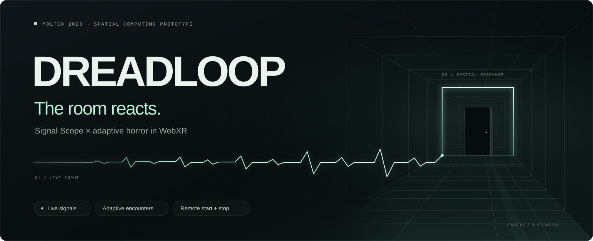
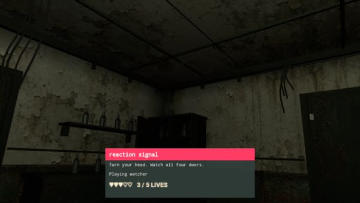
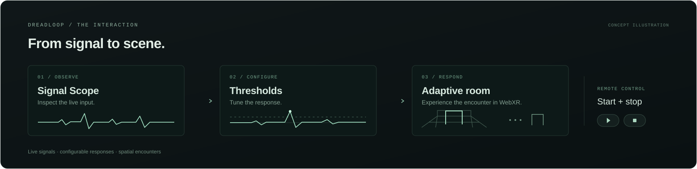
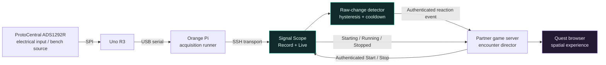

<p align="center">
  
</p>

<p align="center">
  <strong>Live signals. Reactive spaces. One continuous loop.</strong><br>
  Built for MOLTEN · Inglewood · October 17, 2026
</p>

<p align="center">
  <a href="#the-experience">Experience</a> ·
  <a href="#quickstart">Run it</a> ·
  <a href="#connect-a-game">Connect a game</a> ·
  <a href="#hardware">Hardware</a> ·
  <a href="#what-we-verified">Verification</a>
</p>

# Dreadloop × Signal Scope

**Make the room respond.** Dreadloop explores horror that takes cues from the player: a signal changes, a threshold is crossed, and the game gets a fresh opportunity to shape the next encounter.

**Signal Scope** is the instrument panel behind that experience. It brings live waveforms, timestamped reactions, recording, threshold detection, and two-way game control into one local browser workspace. A game can start the acquisition loop, receive reaction hooks, and stop its session without someone juggling terminals on the sensor laptop.

This branch brings together the sensor workspace and the published **Three.js horror game** from [nikhil-s1nha/focused](https://github.com/nikhil-s1nha/focused), plus acquisition firmware, game-link protocols, hardware schematics, offline analysis, and an earlier A-Frame integration starter.

> **Prototype scope:** the current live integration uses **unverified raw electrical counts** and experimental threshold crossings. It is not a validated EEG, heart-rate, or fear classifier. That distinction travels with the data all the way to the game.

## The experience



| Record | Live | Connect |
| --- | --- | --- |
| Watch both raw channels, mark a reaction, and export the capture. | See fresh frames, detector state, rearming, cooldown, and event delivery together. | Let the game's Start/Stop buttons control their own acquisition session. |

1. **Start the game.** Its authenticated Start command reaches Signal Scope.
2. **Watch the signal arrive.** The Live tab shows the waveform and reception state. The game receives a `running` acknowledgment only after fresh frames and forwarding are available.
3. **Cross a threshold.** A qualifying raw-change event becomes a small, explicit `reaction` hook.
4. **Let the world respond.** The game decides when and how that hook affects its encounter director.
5. **Stop once.** The game's Stop ends its owned acquisition and automatic event forwarding. Signal Scope also has a local Stop backup.

The creative idea is larger than a jump scare: **give spatial creators another input they can compose with.** The same event interface can drive atmosphere, pacing, transitions, or interactions in other worlds. Horror is our first demonstration.

**Release boundary:** that complete two-way loop was verified against the partner's running game server. Its latest game-side event/control receiver has not yet been published in the game source included here. The sensor-side implementation and exact contracts are included; a fresh clone needs a compatible receiver before remote Start/Stop and automatic events can work end to end. The included horror game runs independently in demo mode now.

## How the loop works





Raw acquisition and game rendering remain independent. The game receives compact events rather than trying to process every sensor frame. Signal Scope keeps the waveform, timestamps, original capture bytes, and source metadata available for inspection.

### Built for a live demo

- **One workspace:** Record and Live share the same waveform display; switching tabs does not create a competing capture process.
- **Visible state:** receiving, waiting, restarting, stopping, and delivery states are exposed instead of hiding lost frames behind a moving chart.
- **Continuous capture:** recording continues until Stop. Archived captures retain samples and markers beyond the chart's rolling display window.
- **Reaction markers:** Blink, Jaw clench, Startle / flinch, and custom annotations, with CSV/JSON export and marker deletion.
- **Automatic triggers:** a sensitive raw-change preset, hysteresis, a rearm interval, and a five-second cooldown keep a sustained excursion from becoming an event flood.
- **Two-way control:** authenticated remote Start/Stop, session ownership, cancellation of delayed starts, and explicit acknowledgments.
- **Fresh events only:** stale events are dropped; failed deliveries are not replayed as delayed scares.
- **Inspectable hardware:** editable KiCad module-level wiring, PDF/SVG exports, and a netlist verification script.

## Quickstart

The browser workspace runs without a sensor. Start with its explicitly synthetic demo source to explore the graphs and controls.

**Requirements:** Python 3.10+; Node.js 22+ for the optional WebXR starter and JavaScript tests. Commands below run from the repository root on macOS or Linux.

```sh
python3 -m venv backend/.venv
source backend/.venv/bin/activate
python -m pip install -r backend/requirements.txt
python -m backend.viewer_server --host 127.0.0.1 --port 8767
```

Open **[Signal Scope](http://127.0.0.1:8767/)**, choose **Change source → Demo · synthetic waveform**, and select **Use source**. The demo can generate a visibly labeled synthetic spike; it is useful for testing the interface without any hardware.

On Windows, activate with `backend\.venv\Scripts\Activate.ps1` in PowerShell instead of the `source` command.

| Local service | Default address | Purpose |
| --- | --- | --- |
| Signal Scope | `http://127.0.0.1:8767` | Graphs, recording, markers, Live controls |
| Sender API | `http://127.0.0.1:8769` | Partner configuration, event delivery, remote-control connection |
| Three.js horror game | `http://127.0.0.1:8080/simple.html` | Published game and spectator experience |
| Optional XR starter | `http://127.0.0.1:8080` | Independent A-Frame integration scene |

Run the game or the optional starter on port 8080, not both simultaneously. The viewer alone does not enable hardware acquisition. Demo data, diagnostic counts, and verified bench source types remain separate.

### Run the horror game

In another terminal:

```sh
cd haunted-room
npm ci
npm start
```

Open **http://127.0.0.1:8080/simple.html** for the compact horror experience. The root game page also contains the earlier manual/live-slider scene. A spectator page at **http://127.0.0.1:8080/simple.html?spectate=1** can render the player's view on a laptop or connected display.

For Quest, follow the game's [USB forwarding or trusted HTTPS setup](haunted-room/README.md). `npm run quest` is an optional helper that expects an authorized headset and may install Android tooling; review its instructions first. Running the flat browser page is distinct from entering immersive VR.

## Connect a game

In a second terminal, using the same Python environment:

```sh
source backend/.venv/bin/activate
python -m backend.partner_sender --port 8769
```

1. Open **Partner link** in Signal Scope.
2. Enter the partner receiver's reachable base URL and privately shared token. The token stays in sender memory; re-enter it after a sender restart.
3. Send a **manual test** and confirm acceptance on both computers.
4. Confirm the receiver advertises automatic-event and acquisition-control capabilities.
5. Once the bench acquisition prerequisites below are configured, open **Live** and enable **Allow game Start/Stop**.
6. Start a fresh game round. Watch the acknowledgments, waveform, and accepted-event state. Confirm the resulting effect in the headset separately.

Use the partner computer's LAN address, not `127.0.0.1`. Both machines must be able to reach each other. The demo HTTP transport belongs on a trusted network; keep the shared token out of browser game code and Git. An explicitly approved non-private destination can be supplied with `--allow-host HOST`.

### Three small contracts

| Contract | Meaning | Documentation |
| --- | --- | --- |
| `signal-scope.event.v1` | Manual test or operator-marked reaction | [Manual link](partner-signal-link/README.md) |
| `signal-scope.event.v2` | Automatic, unverified threshold crossing | [Threshold protocol](partner-signal-link/THRESHOLD_PROTOCOL.md) |
| `signal-scope.control.v1` | Game-owned Start/Stop with acknowledgments | [Game-control protocol](partner-signal-link/GAME_CONTROL_PROTOCOL.md) |

Automatic events use `source: "threshold_detector"`, `measurement: "threshold_crossing"`, `event: "reaction"`, and `emotion: null`. Their metadata retains `quality: "unverified"`, `valid_measurement: false`, and `reaction_validated: false`. The event's `value` is a game control amount, not a probability of fear.

The partner's live deployment mounts its receiver inside its game server. That latest deployment change is not in the included published game snapshot. Integrate the contracts above or connect to an already compatible receiver; the older `/api/signal` intensity endpoint is a different protocol. The standalone receiver in `partner-signal-link/` is a reference integration option; do not start a second receiver and expect it to share the game's state. See [sensor-side setup](partner-signal-link/SENSOR_SETUP.md) and the [partner handoff](partner-signal-link/NIKHIL_HANDOFF.md).

## Hardware

Our bench chain uses a **ProtoCentral legacy ADS1292R breakout → ELEGOO/Arduino Uno R3 → USB host**. An Orange Pi runs the serial capture runner; a laptop runs Signal Scope. A laptop can also serve as the Uno's USB host for supported direct-USB bench diagnostics. Neither arrangement uses sensor-to-Pi GPIO wires.

### Nine-wire Uno connection

Match the actual board revision and logic selection before applying this reference. Disconnect power while wiring.

| ProtoCentral pin | Uno R3 pin | Purpose |
| --- | --- | --- |
| VDD | 5V | Board supply |
| GND | GND | Common reference |
| SCK | D13 | SPI clock |
| MISO | D12 | Sensor-to-Uno data |
| MOSI | D11 | Uno-to-sensor data |
| CS | D7 | Chip select |
| DRDY | D6 | Data-ready indication |
| START | D5 | Conversion control |
| RESET | D4 | Reset control |

Leave **CLK, GPIO1, and GPIO2** unconnected in this configuration. `CLK` is distinct from SPI `SCK`. The documented breakout was set to **5 V host logic**, matching the Uno. Do not transfer that wiring directly to 3.3 V Pi GPIO.

The three-lead jack is not three independent EEG channels. On the referenced legacy board, tip and ring connect to the differential channel-2 inputs; sleeve is a driven bias path, not plain ground. Lead colors and anatomical placement cannot be inferred from that connector description.

Open the [KiCad schematic and hardware guide](hardware/adaptive-horror/README.md) for the editable design, source references, board-side jack mapping, and exported wiring documentation.

### Hardware acquisition setup

The hardware-free quickstart is portable. The Pi-controlled recording path additionally requires a prepared deployment:

1. Establish normal SSH access to the Pi and identify its Uno serial device.
2. Review the [firmware guide](firmware/README.md), [continuous runner](firmware/run_object_continuous.py), and [recording controller](backend/bench_recorder.py). The runner requires the expected firmware builds, restoration image, and deployment paths.
3. Configure the release controller for your prepared Pi before starting the viewer:

   ```sh
   export SIGNAL_SCOPE_SSH_HOST=YOUR_USER@PI_IP
   export SIGNAL_SCOPE_SSH_CONTROL=/tmp/signal-scope-ssh/control
   export SIGNAL_SCOPE_REMOTE_BASE=/path/to/prepared/runner
   ```

   These variables are read at service startup. Establish the SSH control connection separately; the viewer does not discover devices or install firmware automatically.
4. Validate the disconnected-electrode bench setup before enabling the acquisition controls.
5. Start the viewer with the explicit object-bench option:

   ```sh
   python -m backend.viewer_server --port 8767 --enable-object-bench
   ```

6. Open `http://127.0.0.1:8767/?source=raw_diagnostic`. Use **Record** for an archive or **Live** for game-linked detection. Remote Live sessions do not save an archive by default; local Live can opt into **Save recording**.

Run one acquisition owner at a time. Stop and wait for confirmed firmware restoration before restarting the service or opening another serial reader. The fixed object-bench runner may upload diagnostic firmware and restore its original image; this is not a read-only serial connection.

**Body-connected operation is not enabled by this release.** The ADS1292R breakout is marketed for ECG/respiration, and this prototype has not validated it as a human EEG system. Keep electrodes disconnected during electronic bench tests. A separate review of isolation, cable mapping, configuration, and intended use is required before human acquisition.

## Optional WebXR starter

`adaptive-horror-web/` is our earlier small **A-Frame** integration scene: a dim room, manual intensity slider, BUILD/PEAK/RELIEF director, fog, flicker, shadow figure, opt-in spatial drone, and an in-headset HUD. It is separate from the **Three.js** game in `haunted-room/` and uses its own signal-relay contract.

```sh
cd adaptive-horror-web
npm ci
npm start
```

Open `http://127.0.0.1:8080` for desktop development. Move the manual slider to exercise the director. `python3 mock_feed.py` provides a labeled synthetic input feed for this starter only.

Quest immersive WebXR requires a reachable **secure context**. Use a certificate trusted by the headset or a trusted HTTPS reverse proxy that forwards WebSocket upgrades. The starter accepts `TLS_CERT`, `TLS_KEY`, `HOST`, and `PORT`; see its [README](adaptive-horror-web/README.md). A page opening in the Quest browser does not by itself verify immersive stereo rendering or tracked input.

## Detection and analysis

The demo detector measures raw numerical changes. Its selected preset is `pooled-more-sensitive-v1`, with a normalized threshold of approximately **0.2815**, rearming below **80%** of that threshold after **250 ms**, and a **5-second** event cooldown. These are experimental demo settings, not physiological cutoffs.

The repository also includes a separate causal signal-processing pipeline with high/low-pass filtering, optional mains notch, baseline calibration, and numerical quality gates. That processed path is not silently substituted for the current raw-change detector. See [processing documentation](backend/README.md).

Offline analysis preserves original capture bytes, separates sensor-replacement cohorts, compares marker windows with background windows, and supports whole-recording holdouts. Marker timing can include an independently varying ±0.5-second tolerance. A nearby spike is a candidate match, not proof of the marked action or an emotion.

```sh
python -m backend.reaction_analysis \
  --recordings backend/results/bench-recordings \
  --output backend/results/reaction-analysis
```

Run this after collecting local recordings; it reads completed archives without opening the hardware. The full method and interpretation limits are in [reaction analysis](backend/reaction_analysis/README.md). A high marker-hit rate alone is not accuracy: false triggers and performance on new captures matter too.

## What we verified

| Check | Observed result | What it establishes |
| --- | --- | --- |
| Earlier internal-generator bench test | Device ID `0x73`, 1,251 samples in a ten-second reader window, approximately 125 samples/s | A working chip/transport path at that point in the build |
| Game → Signal Scope Start | Fresh frames and automatic forwarding reached `running` | Remote orchestration and acquisition readiness |
| Signal Scope → partner receiver | Two automatic v2 reaction events accepted in the verified handoff | Authenticated event delivery |
| Matching game Stop | Forwarding and acquisition stopped; restoration confirmed; stopped acknowledgment returned | Owned-session shutdown |
| KiCad reference | Zero ERC violations; exact external-net checks passed | Schematic consistency, not a physical safety certification |

Later hardware readback/status failures remain unresolved in the current diagnostic source. Earlier successful communication does not validate later bytes. The current integration therefore retains raw-count provenance rather than claiming calibrated brain signals. Receiver acceptance also does not prove the headset rendered a specific effect; that is a separate demo check.

### Run the tests

From the repository root, in the Python environment:

```sh
python -m unittest discover -s backend -t . -p 'test_*.py' -v
python -m unittest tools.test_watch_completed_recordings -v
node --test signal-viewer/*.test.mjs
npm --prefix partner-signal-link test
npm --prefix haunted-room test
npm --prefix adaptive-horror-web test
```

The suites cover filtering, parsing, timestamps, recording/export behavior, marker alignment, threshold rearming, duplicate suppression, stale input, Start/Stop races, session ownership, protocol validation, and UI state. Automated tests use fixtures and mocks; they do not establish human EEG validity or physical headset behavior.

## Project map

```text
backend/                    Acquisition adapters, viewer server, processing,
                            live detector, sender, remote game control, tests
signal-viewer/              Signal Scope browser UI: Record, Live, waveforms
haunted-room/               Published Three.js horror game and spectator view
firmware/                   Uno sketches, serial tools, bounded bench diagnostics
hardware/adaptive-horror/   KiCad module schematic, exports, netlist checks
partner-signal-link/        Receiver/client reference and event/control contracts
adaptive-horror-web/        Optional A-Frame WebXR integration starter
tools/                     Completed-recording analysis worker
docs/assets/               README visuals
staging/                   Undeployed proposals and reviewable patches
```

## What is included

Source code, tests, firmware, wiring schematics, protocols, and documentation are versioned. Raw recordings, local analysis results, credentials, downloaded toolchains, and personal media stay local. `staging/` preserves unfinished proposals, including the graph-smoothness patch; these files are **not loaded by Signal Scope** and have not been deployed.

## Credits

- **[ProtoCentral ADS1292R hardware](https://github.com/Protocentral/ADS1292rShield_Breakout)** and **[Arduino library](https://github.com/Protocentral/protocentral-ads1292r-arduino)** — breakout references and driver starting point.
- **[Texas Instruments ADS1292R](https://www.ti.com/product/ADS1292R)** — device documentation and acquisition specifications.
- **[Arduino](https://www.arduino.cc/)** — Uno/AVR tooling and SPI platform.
- **[NumPy](https://numpy.org/)** and **[SciPy](https://scipy.org/)** — numerical processing and analysis.
- **[A-Frame](https://aframe.io/)** and **[ws](https://github.com/websockets/ws)** — the included WebXR starter and WebSocket relay.
- **[Three.js](https://threejs.org/)** and **[Node.js](https://nodejs.org/)** — the partner game and game-server stack.
- **[KiCad](https://www.kicad.org/)** — editable wiring documentation.
- **Kenney assets** used by the published game retain their [included license](haunted-room/public/models/KENNEY-LICENSE.txt); see the game documentation for its asset inventory.

Existing-game research is documented in the starter README. Research links are not claims that those projects' code or assets were incorporated. Preserve applicable third-party licenses when adapting any starting point.

---

**The next step:** validate the acquisition path, calibrate on fresh recordings, and keep extending the creator-facing event interface. The long-term vision is a world that responds to its player. This release delivers the observable signal-to-game loop that makes that exploration possible.
